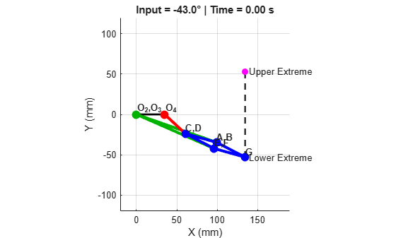
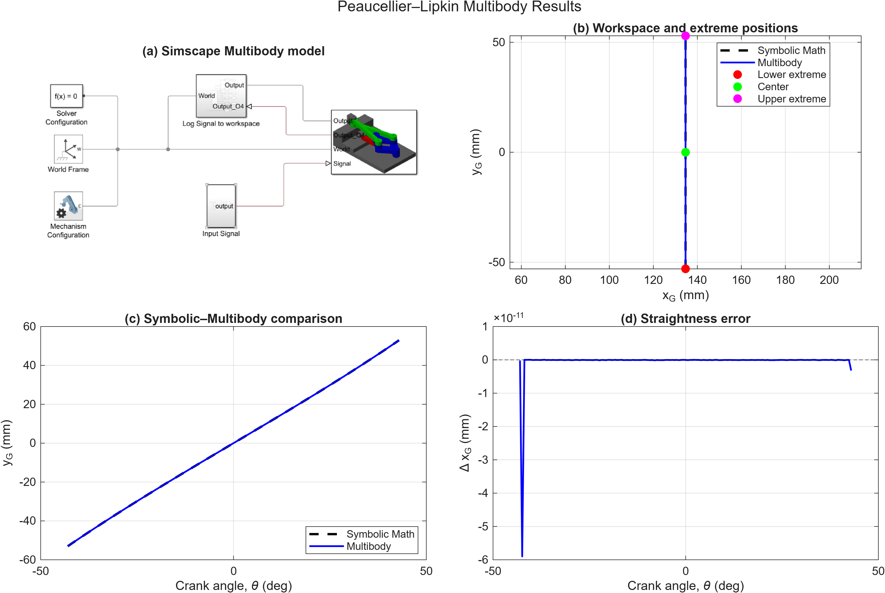
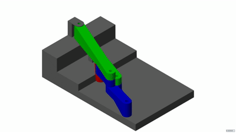

## Project overview

- **Project name:** Peaucellier Straight-Line Mechanism
- **Problem / purpose:** 
- **Team:** กลุ่มนี้ไม่ใช้เไ
- **Status:** Planning
- **Last updated:** [2026-11-10]
- **Group Members:**
  |Name|Student ID|
  |---|---|
  |Torpat Sirilattaporn|6730192621|
  |Thanayut Thawornpracha|6730222821|
  |Ruj Samarnworakit|6730454021|

## Repository structure

| Path | Purpose |
|---|---|
| `hardware/mechanical/` | CAD models, drawings, and fabrication files |
| `hardware/bom.csv` | Bill of materials with quantities, units, and sourcing details |
| `machine-skills/` | Machine commands, procedures, and skill instructions |
| `simulation/` | Models, scripts, assumptions, and simulation results |
| `docs/` | Assembly, setup, operation, and maintenance instructions |
| `media/` | Images, GIFs, and links to demonstration videos |
| `experiments/` | Procedures, raw data, and results |
| `publications/` | Project-related journal and conference papers |

## Collaboration and file practices

Use descriptive filenames and commit messages. Record units, revisions, software versions, and assumptions. Keep editable source files where practical. Avoid committing credentials, private data, temporary files, or duplicate exports. Consider Git LFS for large CAD, simulation, and video files.

## Safety and validation

Document hazards, safeguards, and operating limits before testing hardware. Validate important calculations and simulation results against measurements where practical.

## Part I: Basics including kinematic diagram, DoF analysis

The Peaucellier–Lipkin mechanism consists of **8 links**, including the ground, connected by revolute joints. Link 4 serves as the input crank, while joint G produces straight-line motion.

### 1.1. Link and Joint Identification

| Link | Description | Length |
|:---:|---|:---:|
| 1 | Ground (O₂,O₃–O₄) | 35 mm |
| 2–3 | Connecting links (O₂–A, O₃–E) | 105 mm |
| 4 | Input crank (O₄–C,D) | 35 mm |
| 5–8 | Rhombus links (A–C, D–E, B–G, F–G) | 40 mm |

The mechanism has **6 physical revolute joint locations**: O₂/O₃, O₄, A/B, C/D, E/F, and G. Four locations connect three links each, giving **10 equivalent revolute joints**.

### 1.2. Degrees of Freedom (DOF)

Using the planar Grübler–Kutzbach equation:

$$
DOF = 3(n-1)-2J_1-J_2
$$

where:
- n = 8 links
- J₁ = 10 equivalent revolute joints
- J₂ = 0 higher pairs

The four ternary joint locations (O₂,O₃; A/B; C/D; E/F) each count as two equivalent revolute joints, while O₄ and G each count as one.

Substituting:

$$
DOF = 3(8-1)-2(10)=\boxed{1}
$$

The mechanism has **one degree of freedom**, controlled by the rotation of Link 4.

### 1.3. Workspace Analysis

The output joint G follows an exact vertical straight-line path. Using the link dimensions of a = 105 mm, b = 40 mm, and r = 35 mm, the workspace was evaluated in MATLAB.

| Parameter | Value |
|---|---:|
| Horizontal position (xG) | 134.64 mm |
| Input angle range | −43.00° to +43.00° |
| Vertical range (yG) | −53.04 to +53.04 mm |
| Total output stroke | **106.08 mm** |

The results confirm that joint G moves along a vertical straight line with a total evaluated stroke of **106.08 mm**.

## Part II: Symbolic Math for the Selected Mechanism

### 2.1. MATLAB Kinematic Simulation

The Peaucellier–Lipkin mechanism was analyzed in MATLAB using symbolic mathematics to determine the position, velocity, and acceleration of output joint G. The input crank (Link 4) was driven at a constant angular velocity of **1 rad/s**, while the remaining links moved according to the geometric constraints of the mechanism.

- [View MATLAB Script (.m)](simulation/Symbolic%20Math/SymbolicMath.m)
- [Download MATLAB Live Script (.mlx)](simulation/Symbolic%20Math/SymbolicMath.mlx)

### 2.2. Governing Equations and Position Analysis

The Peaucellier–Lipkin mechanism operates based on the **geometric inversion principle**, which relates the distances from the coincident fixed pivots O₂,O₃ to the input joint C/D and output joint G:

$$
O_2(C,D)\times O_2G=a^2-b^2
$$

Taking O₂,O₃ as the origin and O₄ at (r, 0), the input joint C/D moves along a circular path as Link 4 rotates. Its coordinates are expressed as:

$$
x_{C,D}=r(1+\cos\theta)
$$

$$
y_{C,D}=r\sin\theta
$$

where θ is the angular displacement of Link 4. Since O₂,O₃, C/D, and G remain collinear, the inversion relationship can be used to determine the output position:

$$
x_G=\frac{a^2-b^2}{2r}=L
$$

$$
y_G=L\tan\left(\frac{\theta}{2}\right)
$$

where **a = 105 mm** is the length of Links 2–3, **b = 40 mm** is the length of Links 5–8, and **r = 35 mm** is both the input crank length (Link 4) and the distance between fixed pivots O₂,O₃ and O₄.

Substituting these dimensions:

$$
L=\frac{105^2-40^2}{2(35)}=134.64\text{ mm}
$$

Since the horizontal position of G remains constant, the joint follows an **exact vertical straight-line path**.

### 2.3. Velocity and Acceleration Analysis

The velocity and acceleration of output joint G are obtained by differentiating its position equations with respect to time. Since the horizontal position remains constant, both horizontal velocity and acceleration are zero.

**Velocity:**

$$
v_{Gx}=\frac{dx_G}{dt}=0
$$

$$
v_{Gy}=\frac{dy_G}{dt}=\frac{L}{2}\sec^2\left(\frac{\theta}{2}\right)\omega
$$

**Acceleration:**

$$
a_{Gx}=\frac{d^2x_G}{dt^2}=0
$$

$$
a_{Gy}=\frac{dv_{Gy}}{dt}=\frac{L}{2}\sec^2\left(\frac{\theta}{2}\right)\left[\alpha+\omega^2\tan\left(\frac{\theta}{2}\right)\right]
$$

where **ω** and **α** represent the angular velocity and angular acceleration of Link 4, respectively. For the numerical analysis, a constant angular velocity of **ω = 1 rad/s** and zero angular acceleration (**α = 0 rad/s²**) are assumed.

These equations describe the vertical motion of joint G as the input crank rotates, providing the analytical reference for comparison with the Simscape Multibody simulation in Part III.

## Part III: Simscape Multibody 
### 3.1. Simulation Setup

The Peaucellier–Lipkin mechanism was modeled in MATLAB R2026a using Simscape Multibody. The model uses the same link dimensions and kinematic configuration defined in Parts I and II.

The input angle $\theta$ was measured from the `Input_O4` Revolute Joint, while a Transform Sensor measured the horizontal and vertical positions of output point $G$ in the World frame. The crank completed one constant-speed sweep at $1\ \text{rad/s}$.

The recorded input range was $-43.0000^\circ$ to $+42.9437^\circ$. The small difference from the intended symmetric range of $\pm43^\circ$ results from the final discrete simulation time step.

The Multibody positions were compared with the Symbolic Math results from Part II at the same recorded crank angles.

Relevant files:

- [Simscape Multibody model](simulation/multibody/Peaucellier.slx)
- [Result-analysis script](simulation/multibody/plot_peaucellier_results.mlx)

### 3.2. Extreme Positions and Working Space

The working extremes were identified from the minimum and maximum vertical positions of point $G$.

| Configuration | Crank angle | $x_G$ | $y_G$ |
|---|---:|---:|---:|
| Lower extreme | $-43.0000^\circ$ | 134.642857 mm | −53.037232 mm |
| Center sample | $-0.0282^\circ$ | 134.642857 mm | −0.033094 mm |
| Upper extreme | $+42.9437^\circ$ | 134.642857 mm | +52.960789 mm |

The Multibody working stroke was therefore

$$
S_{\mathrm{MB}}=105.998021\ \text{mm}.
$$

The center sample is slightly displaced from exactly $0^\circ$ because the results are stored at discrete time steps. The horizontal coordinate remains effectively constant throughout the sweep, so the working space of point $G$ is a vertical line segment.

### 3.3. Symbolic–Multibody Comparison

| Quantity | Result |
|---|---:|
| Symbolic Math stroke | 105.998121 mm |
| Simscape Multibody stroke | 105.998021 mm |
| Stroke difference | $-1.00422\times10^{-4}$ mm |
| Maximum vertical-position difference | $2.11812\times10^{-4}$ mm |
| Maximum horizontal deviation | $5.90035\times10^{-11}$ mm |
| Straightness band | $5.90319\times10^{-11}$ mm |

The Symbolic Math and Multibody vertical-position curves overlap throughout the simulated range. Their stroke values differ by approximately $0.000100$ mm, while the maximum vertical-position difference is approximately $0.000212$ mm. These small differences are attributed to solver tolerances, interpolation, and discrete time sampling.

Straightness was evaluated from the transverse error

$$
\Delta x_G = x_{G,\mathrm{MB}} - x_{G,\mathrm{symbolic}}.
$$

The maximum transverse deviation was $5.90\times10^{-11}$ mm, which is far below the selected numerical tolerance of $1.0\times10^{-6}$ mm. The visible fluctuations in the straightness-error graph therefore represent numerical noise rather than physical curvature of the path.

*Figure 1. (a) Simscape Multibody model. (b) Workspace and extreme positions of point G. (c) Symbolic–Multibody position comparison. (d) Transverse straightness error.*

### 3.4. Conclusion

The Simscape Multibody results agree closely with the Symbolic Math analysis. Point $G$ completed a working stroke of $105.998021$ mm while maintaining an effectively constant horizontal position.

The measured transverse deviation remained within the numerical precision of the solver. The ideal Multibody model can therefore be considered to reproduce the theoretical straight-line motion over the evaluated working range.

The video shows one complete cycle, with the output pin traversing its full operating range. [Download Video (.avi)](media/Peaucellier.avi)

## Part IV: Built Mechanism

