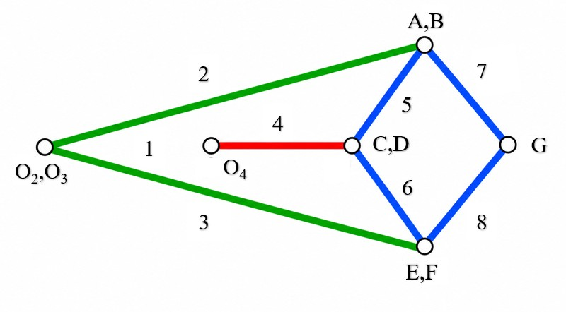
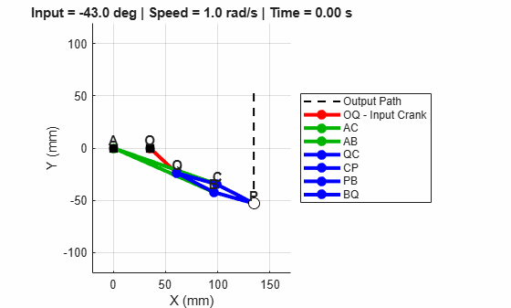
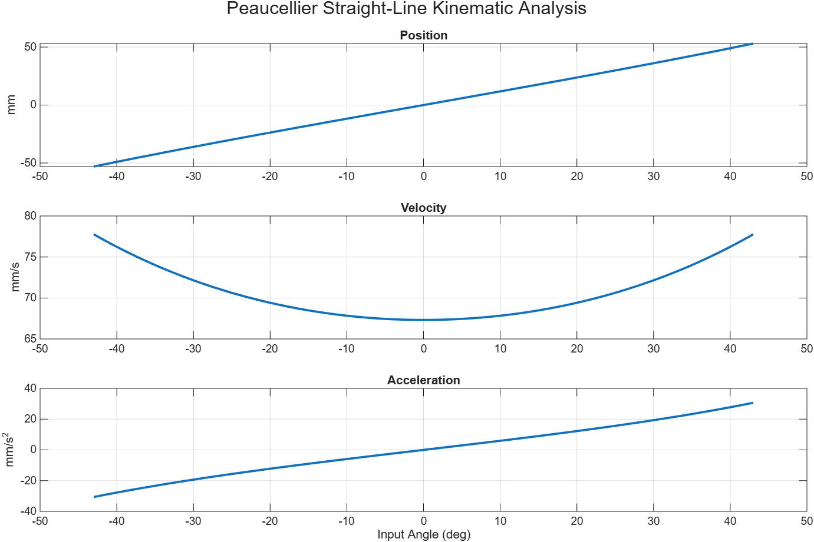
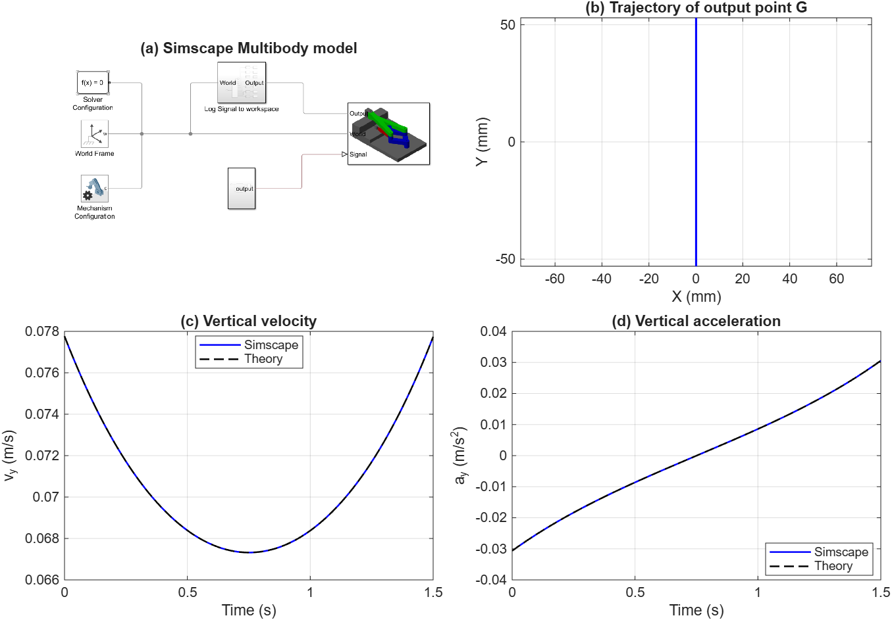
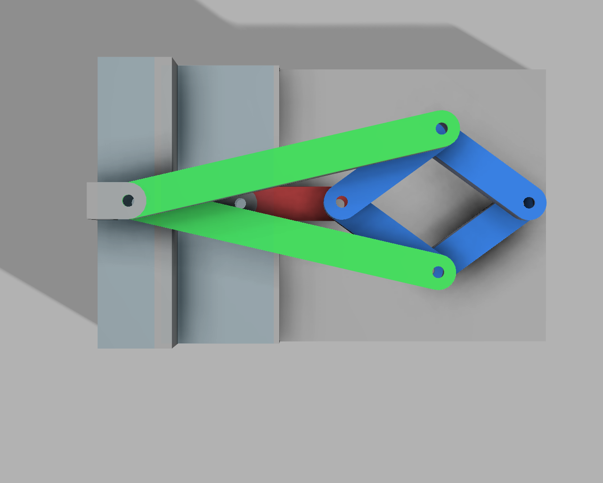
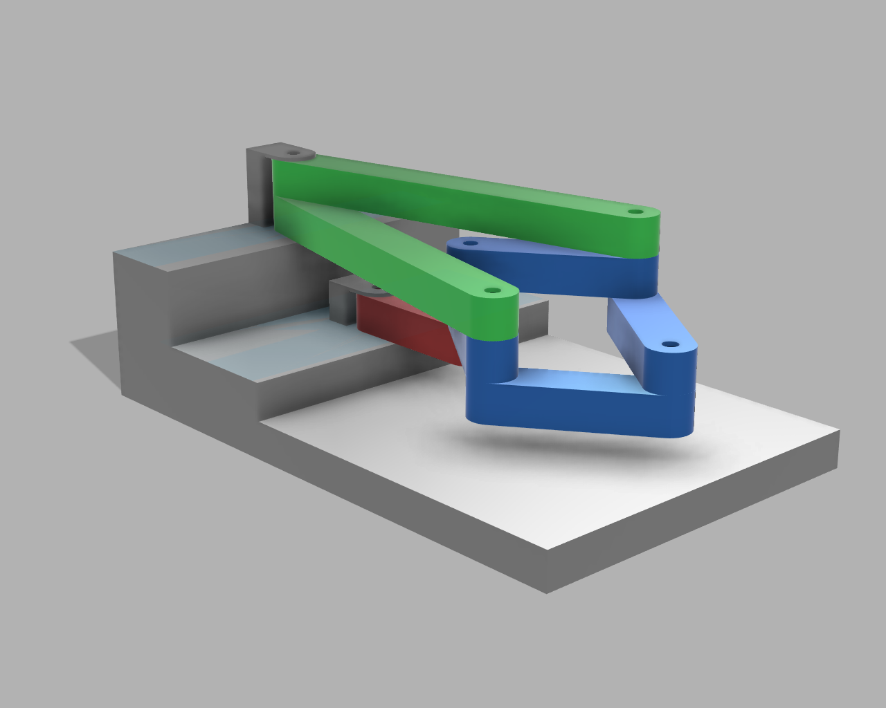

## Project overview

- **Project name:** Peaucellier Straight-Line Mechanism
- **Problem / purpose:** 
- **Team:** กลุ่มนี้ไม่ใช้เไ
- **Status:** Planning
- **Last updated:** [2026-11-03]
- **Group Members:**
  |Name|Student ID|
  |---|---|
  |Torpat Sirilattaporn|6730192621|
  |Thanayut Thawornpracha|6730222821|
  |Ruj Samarnworakit|6730454021|

## Repository structure

| Path | Purpose |
|---|---|
| `hardware/mechanical/` | CAD models, drawings, and fabrication files |
| `hardware/bom.csv` | Bill of materials with quantities, units, and sourcing details |
| `machine-skills/` | Machine commands, procedures, and skill instructions |
| `simulation/` | Models, scripts, assumptions, and simulation results |
| `docs/` | Assembly, setup, operation, and maintenance instructions |
| `media/` | Images, GIFs, and links to demonstration videos |
| `experiments/` | Procedures, raw data, and results |
| `publications/` | Project-related journal and conference papers |

## Collaboration and file practices

Use descriptive filenames and commit messages. Record units, revisions, software versions, and assumptions. Keep editable source files where practical. Avoid committing credentials, private data, temporary files, or duplicate exports. Consider Git LFS for large CAD, simulation, and video files.

## Safety and validation

Document hazards, safeguards, and operating limits before testing hardware. Validate important calculations and simulation results against measurements where practical.

## Part I: Basics including kinematic diagram, DoF analysis

The Peaucellier–Lipkin mechanism consists of **8 links**, including the ground, connected by revolute joints. Link 4 serves as the input crank, while joint G produces straight-line motion.

### 1.1. Link and Joint Identification

| Link | Description | Length |
|:---:|---|:---:|
| 1 | Ground (O₂,O₃–O₄) | 35 mm |
| 2–3 | Connecting links (O₂–A, O₃–E) | 105 mm |
| 4 | Input crank (O₄–C,D) | 35 mm |
| 5–8 | Rhombus links (A–C, D–E, B–G, F–G) | 40 mm |

The mechanism has **6 physical revolute joint locations**: O₂,O₃, O₄, A/B, C/D, E/F, and G. Four locations connect three links each, giving **10 equivalent revolute joints**.

### 1.2. Degrees of Freedom (DOF)

Using the planar Grübler–Kutzbach equation:

$$
DOF = 3(n-1)-2J_1-J_2
$$

where:
- n = 8 links
- J₁ = 10 equivalent revolute joints
- J₂ = 0 higher pairs

The four ternary joint locations (O₂,O₃; A/B; C/D; E/F) each count as two equivalent revolute joints, while O₄ and G each count as one.

Substituting:

$$
DOF = 3(8-1)-2(10)=\boxed{1}
$$

The mechanism has **one degree of freedom**, controlled by the rotation of Link 4.

### 1.3. Workspace Analysis

The output joint G follows an exact vertical straight-line path. Using the link dimensions of a = 105 mm, b = 40 mm, and r = 35 mm, the workspace was evaluated in MATLAB.

| Parameter | Value |
|---|---:|
| Horizontal position (xG) | 134.64 mm |
| Input angle range | −43.00° to +43.00° |
| Vertical range (yG) | −53.04 to +53.04 mm |
| Total output stroke | **106.08 mm** |

The results confirm that joint G moves along a vertical straight line with a total evaluated stroke of **106.08 mm**.

## Part II: Symbolic Math for the Selected Mechanism

### 2.1. MATLAB Kinematic Simulation

The Peaucellier–Lipkin mechanism was analyzed in MATLAB using symbolic mathematics to determine the position, velocity, and acceleration of output joint G. The input crank (Link 4) was driven at a constant angular velocity of **1 rad/s**, while the remaining links moved according to the geometric constraints of the mechanism.

- [View MATLAB Script (.m)](simulation/Symbolic%20Math/SymbolicMath.m)
- [Download MATLAB Live Script (.mlx)](simulation/Symbolic%20Math/SymbolicMath.mlx)

### 2.2. Governing Equations and Position Analysis

The Peaucellier–Lipkin mechanism operates based on the **geometric inversion principle**, which relates the distances from the coincident fixed pivots O₂,O₃ to the input joint C/D and output joint G:

$$
O_2(C,D)\times O_2G=a^2-b^2
$$

Taking O₂,O₃ as the origin and O₄ at (r, 0), the input joint C/D moves along a circular path as Link 4 rotates. Its coordinates are expressed as:

$$
x_{C,D}=r(1+\cos\theta)
$$

$$
y_{C,D}=r\sin\theta
$$

where θ is the angular displacement of Link 4. Since O₂,O₃, C/D, and G remain collinear, the inversion relationship can be used to determine the output position:

$$
x_G=\frac{a^2-b^2}{2r}=L
$$

$$
y_G=L\tan\left(\frac{\theta}{2}\right)
$$

where **a = 105 mm** is the length of Links 2–3, **b = 40 mm** is the length of Links 5–8, and **r = 35 mm** is both the input crank length (Link 4) and the distance between fixed pivots O₂,O₃ and O₄.

Substituting these dimensions:

$$
L=\frac{105^2-40^2}{2(35)}=134.64\text{ mm}
$$

Since the horizontal position of G remains constant, the joint follows an **exact vertical straight-line path**.

### 2.3. Velocity and Acceleration Analysis

The velocity and acceleration of output joint G are obtained by differentiating its position equations with respect to time. Since the horizontal position remains constant, both horizontal velocity and acceleration are zero.

**Velocity:**

$$
v_{Gx}=\frac{dx_G}{dt}=0
$$

$$
v_{Gy}=\frac{dy_G}{dt}=\frac{L}{2}\sec^2\left(\frac{\theta}{2}\right)\omega
$$

**Acceleration:**

$$
a_{Gx}=\frac{d^2x_G}{dt^2}=0
$$

$$
a_{Gy}=\frac{dv_{Gy}}{dt}=\frac{L}{2}\sec^2\left(\frac{\theta}{2}\right)\left[\alpha+\omega^2\tan\left(\frac{\theta}{2}\right)\right]
$$

where **ω** and **α** represent the angular velocity and angular acceleration of Link 4, respectively. For the numerical analysis, a constant angular velocity of **ω = 1 rad/s** and zero angular acceleration (**α = 0 rad/s²**) are assumed.

These equations describe the vertical motion of joint G as the input crank rotates, providing the analytical reference for comparison with the Simscape Multibody simulation in Part III.

## Part III: Simscape Multibody 
The Peaucellier–Lipkin mechanism was modeled in MATLAB R2026a using Simscape Multibody. The planar assembly contains seven moving rigid links and ten revolute joints. The pin-to-pin lengths of the long links, rhombus links, and input crank are 105 mm, 35 mm, and 40 mm, respectively. The crank was driven sinusoidally through ±30° with a period of 8 s. One complete cycle was simulated with a fixed time step of 0.01 s.

A Transform Sensor measured the position, velocity, and acceleration of the output pin center $P$ in World coordinates. The simulated motion was compared with the analytical relation $y_P = x_0 \tan(\theta/2)$, where $x_0 = 134.643$ mm is the nominal horizontal position and $\theta$ is the prescribed crank angle.

**Figure 1.** (a) Simscape Multibody model showing the fixed pivots and output point $P$. (b) Measured trajectory of $P$. (c) Vertical velocity and (d) vertical acceleration compared with analytical predictions.

**Table 1. Numerical results for one input cycle.**

| Quantity | Result |
| --- | ---: |
| Vertical stroke of point $P$ | 72.155 mm |
| Peak vertical speed | 0.027685 m/s |
| Peak vertical acceleration magnitude | 0.023305 m/s² |
| Maximum horizontal deviation from the theoretical line | $5.98 \times 10^{-11}$ mm |
| Maximum absolute difference in vertical velocity from the analytical prediction | $1.01 \times 10^{-14}$ m/s |
| Maximum absolute difference in vertical acceleration from the analytical prediction | $8.14 \times 10^{-12}$ m/s² |

The output followed a vertical path and reversed direction at each end of the stroke. The largest acceleration difference occurred at $t=0$.

<!-- Add the AVI to media/Mechanism.avi at the repository root, then uncomment the line below.
[Download the simulation video (Mechanism.avi)](../../media/Mechanism.avi). The video shows one complete cycle, with the output pin traversing its full operating range.
-->

## Part IV: Built Mechanism

